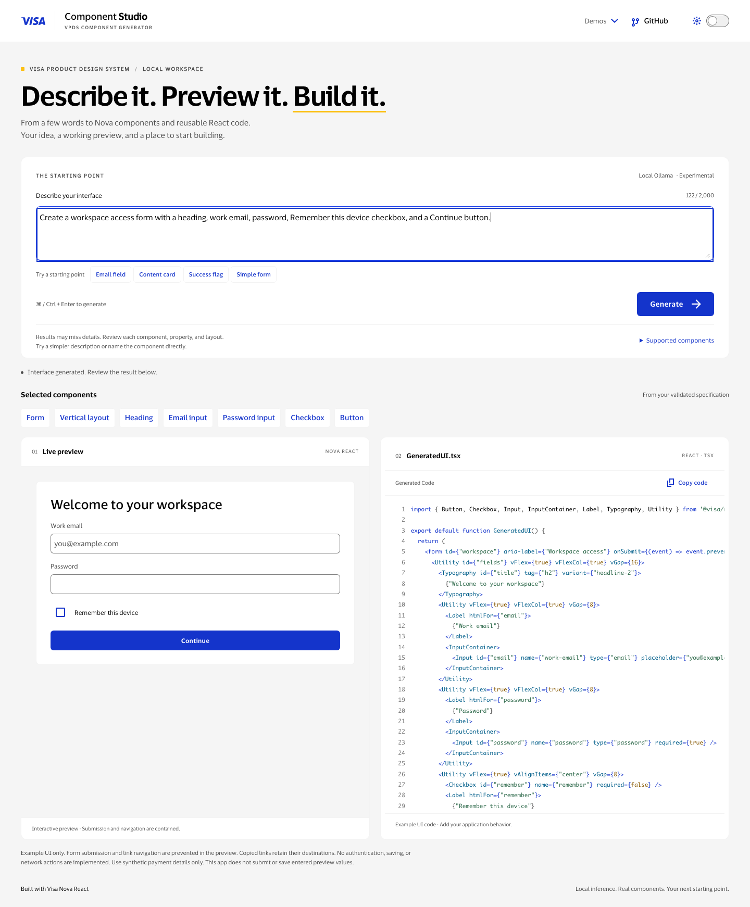

# VPDS Component Generator

Describe an interface in natural language. Local Ollama selects Visa Nova React components; TypeScript validates and composes one specification into component suggestions, an interactive preview, and copyable React TSX.



The screenshot uses a fixture, not a claim about model accuracy. This is a **local AI application**. The [older Vercel demo](https://vpds-component-generator-s1a9.vercel.app/) is not provisioned with this Express/Ollama backend.

## Run locally

Prerequisites: Node **22.14+ on Node 22**, npm, Ollama bound to `127.0.0.1:11434`, and the installed `qwen3:4b-instruct` model. No paid API or key is required.

```bash
npm ci
ollama list
```

If Ollama is not already running, start it in a dedicated terminal:

```bash
OLLAMA_HOST=127.0.0.1:11434 ollama serve
```

Start the API and frontend in separate terminals from the repository root:

```bash
npm run dev:backend:ai
```

```bash
npm run dev -- --port 5173 --strictPort
```

Open **http://127.0.0.1:5173/**. Check `curl http://127.0.0.1:5173/api/health` for `provider: ollama-local-flat-selection` and `isMock: false`. Health confirms configuration/liveness, not model readiness.

Stop each owned watcher with **Ctrl+C** in its terminal. Stop a terminal-owned Ollama server with Ctrl+C only when you intend to stop that service; leave unrelated services running. See [development](docs/development.md) for environment configuration and occupied-port recovery.

## Supported interfaces

Twenty selectable families: text/email/password inputs, textarea, checkbox, switch, radio group, native select, button, heading, text, link, text badge, divider, content card, payment-card fields, linear progress, dialog, flag, and footer.

Examples to try:

- “Create a text input labeled Full name.”
- “Create a multiline Notes field.”
- “Create a switch labeled Email alerts.”
- “Create a login form with remember me.”
- “Create a footer with Copyright 2026 and a Privacy link pointing to https://example.com/privacy.”

The selection contract supports one optional form, vertical stacking and adjacent horizontal groups. These are experimental capabilities: the model can select the wrong family, omit states or labels, or miss grouping requirements. Validation and compilable TSX do not prove that the request was understood. Review each result; try a simpler description or name the component directly.

Preview submissions/navigation are contained. Copied links retain their destinations. Generated code provides example UI, not authentication, persistence or payment processing. Payment fields do not perform full card validation; use synthetic values. Preview values are not submitted, stored or logged by the generator.

The **Demos** menu retains the separate keyword and specification demos. The main AI path has no keyword or mock fallback.

## Repository

```text
apps/web                    React/Vite workspace and secondary demos
apps/api/src/ai              Ollama transport, selection, compiler, compatibility
packages/ui-specification   Shared validation, Nova presentation and TSX generation
tools/evaluation            Manual evaluation tooling and retained tests
docs                        Current guides and selected evaluation evidence
```

```bash
npm run build       # shared package, web, API
npm run lint
npm test            # web, shared specification, API and evaluation tests
```

- [Development and shutdown](docs/development.md)
- [Architecture and safety boundaries](docs/architecture.md)
- [Limitations and selected evidence](docs/limitations.md)
- [Evaluation protocol and selected evidence](docs/evaluation/README.md)

CI uses mocks/fake local HTTP servers and does not download models or run inference. Static frontend hosting alone does not deploy the local AI system. No production hosting configuration is provided.
